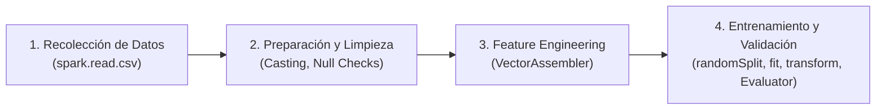

# GUÍA MAESTRA DE EXPOSICIÓN Y DEMOSTRACIÓN: REGRESIÓN LINEAL CON PYSPARK (LI21)

**Institución:** Universidad del Valle (UNIVALLE)  
**Asignatura:** Tecnologías Emergentes I  
**Docente:** Lic. Efraín Luna Flores  
**Estudiante:** Ronald Joel Saavedra Vargas  
**Cuaderno de Trabajo:** `rsaavedra_lr2.ipynb`  
**Dataset Seleccionado:** Combined Cycle Power Plant (CCPP) (`Folds5x2_pp.csv`)  

---

## ÍNDICE DE CONTENIDOS (Correspondencia Estricta con la Guía LI21)

1. [Paso 1: Acceso a Google Colab](#paso-1-acceso-a-google-colab)
2. [Paso 2: Creación y Nomenclatura del Cuaderno de Trabajo](#paso-2-creación-y-nomenclatura-del-cuaderno-de-trabajo)
3. [Paso 3: Verificación de Usuario Asociado en Google Colab](#paso-3-verificación-de-usuario-asociado-en-google-colab)
4. [Paso 4: Reserva Oficial del Dataset en el Grupo de WhatsApp](#paso-4-reserva-oficial-del-dataset-en-el-grupo-de-whatsapp)
5. [Paso 5: Aplicación del Pipeline PySpark de LI22](#paso-5-aplicación-del-pipeline-pyspark-de-li22)
6. [Paso 6: Exposición Teórico-Práctica (Puntos 6.a a 6.g)](#paso-6-exposición-teórico-práctica)
   - [6.a. ¿Qué es una Regresión Lineal? (Intuitivo, Matemático y Supuestos)](#6a-qué-es-una-regresión-lineal)
   - [6.b. Escenarios de Aplicación de la Regresión Lineal](#6b-escenarios-de-aplicación)
   - [6.c. Descripción Físico-Termodinámica del Dataset CCPP](#6c-descripción-del-dataset-seleccionado)
   - [6.d. Ciclo de Machine Learning y su Relación Directa con el Código](#6d-ciclo-de-machine-learning-y-relación-con-el-código)
   - [6.e. Demostración de Ejecución Paso a Paso en Google Colab](#6e-demostración-en-google-colab)
   - [6.f. Interpretación Física de los Resultados Obtenidos](#6f-interpretación-de-resultados)
   - [6.g. Análisis Exhaustivo de Métricas de Error y Criterios de Selección](#6g-métricas-de-error-y-criterios-de-selección)
7. [Banco de Preguntas y Respuestas para la Defensa Oral](#banco-de-preguntas-y-respuestas-para-la-defensa-oral)

---

## PASO 1: ACCESO A GOOGLE COLAB
1. Abrir el navegador e ingresar a la URL oficial: [https://colab.research.google.com/](https://colab.research.google.com/)
2. Iniciar sesión con la cuenta de correo de Google del estudiante (`ronald...` / cuenta universitaria o personal).

---

## PASO 2: CREACIÓN Y NOMENCLATURA DEL CUADERNO DE TRABAJO
El documento de cátedra exige la regla:
$$\text{[Letra de primer nombre]} + \text{[Apellido]} + \text{\_lr2.ipynb}$$
* **Nombre del estudiante:** Ronald Saavedra
* **Nombre estricto del archivo:** `rsaavedra_lr2.ipynb`
* El archivo `.ipynb` ha sido generado en este directorio listo para ser subido a Colab mediante el menú: `Archivo` $\rightarrow$ `Subir cuaderno`.

---

## PASO 3: VERIFICACIÓN DE USUARIO ASOCIADO EN GOOGLE COLAB
En la esquina superior derecha del entorno de Google Colab se encuentra el avatar de la cuenta activa.
* **Instrucción para la defensa/captura:**
  1. Hacer clic sobre el círculo con la foto de perfil en la esquina superior derecha de Colab.
  2. Se desplegará la tarjeta emergente con el nombre del usuario y la dirección de correo electrónico (idéntico al ejemplo de la guía docente con `efrainf.luna@gmail.com`).
  3. Tomar la captura de pantalla asegurando que se visualice simultáneamente:
     - La pestaña del navegador con el nombre `rsaavedra_lr2.ipynb`.
     - El título interno del cuaderno `rsaavedra_lr2.ipynb`.
     - La ventana modal con el usuario logueado.

---

## PASO 4: RESERVA OFICIAL DEL DATASET EN EL GRUPO DE WHATSAPP
Copiar y pegar el siguiente texto en el grupo de WhatsApp del curso para asegurar la exclusividad del dataset:

```text
[RESERVA OFICIAL DE DATASET - LI21]

Estimado Lic. Efraín Luna y compañeros:

Por medio del presente mensaje, declaro y reservo oficialmente el siguiente dataset para mi exposición y demostración de Regresión Lineal (LI21):

- Estudiante: Ronald Joel Saavedra Vargas
- Nombre del Dataset: Combined Cycle Power Plant (CCPP)
- Archivo fuente: Folds5x2_pp.csv
- Enlace oficial UCI: https://archive.ics.uci.edu/dataset/294/combined+cycle+power+plant
- Enlace alternativo: https://www.kaggle.com/datasets/itsmesunil/combined-cycle-power-plant-dataset
- Resumen: Dataset de 9,568 observaciones de una planta eléctrica de ciclo combinado a plena carga durante 6 años (2006-2011). Cuenta con 4 variables predictoras ambientales (Temperatura, Presión de Vacío, Presión Atmosférica, Humedad Relativa) y 1 variable objetivo continua: Producción Eléctrica Neta por Hora (PE en Megavatios).
```

---

## PASO 5: APLICACIÓN DEL PIPELINE PYSPARK DE LI22
En el trabajo práctico LI22 se ejecutó la implementación en Apache Spark (PySpark MLlib) para procesamiento distribuido.
En `rsaavedra_lr2.ipynb` se aplica rigurosamente este pipeline:
1. Inicialización de sesión Spark distribuida (`SparkSession.builder.appName("rsaavedra_lr2").getOrCreate()`).
2. Carga estructurada de `Folds5x2_pp.csv` mediante `spark.read.csv(..., inferSchema=True, header=True)`.
3. Vectorización de características independientes con `VectorAssembler(inputCols=['AT', 'V', 'AP', 'RH'], outputCol='features')`.
4. Partición determinística en entrenamiento (80%) y prueba (20%) con semilla fija `seed=42`.
5. Instanciación y ajuste del modelo con `LinearRegression(featuresCol='features', labelCol='PE')`.
6. Transformación y generación de predicciones sobre el conjunto de test.
7. **Conversión a RDD y tuplas** idéntica al pantallazo docente:
   ```python
   predictions_and_actuals = predictions.select("prediction", "PE")
   predictions_and_actuals_rdd = predictions_and_actuals.rdd
   predictions_and_actuals_rdd.take(2)
   predictions_and_actuals_rdd = predictions_and_actuals_rdd.map(tuple)
   predictions_and_actuals_rdd.take(2)
   ```
8. Evaluación con `RegressionEvaluator` para $R^2$, RMSE, MSE y MAE.

---

## PASO 6: EXPOSICIÓN TEÓRICO-PRÁCTICA

### 6.a. ¿Qué es una Regresión Lineal?

#### Explicación Sencilla e Intuitiva (Para todo público)
Imagina que trabajas en una cafetería y quieres predecir cuántos cafés calientes venderás cada día. Intuitivamente sabes que en los días con temperaturas bajo cero venderás muchos más cafés que en un día soleado de verano con $35^\circ\text{C}$.

Si colocas en una hoja de papel la temperatura en el eje horizontal ($X$) y los cafés vendidos en el eje vertical ($Y$), verás una nube de puntos que desciende a medida que hace más calor. Si tomas una regla y trazas **la línea recta que pase lo más cerca posible de todos los puntos**, has construido un modelo de **Regresión Lineal**. Esa línea recta te permite pronosticar: *"Si mañana hará $10^\circ\text{C}$, la línea me indica que venderemos aproximadamente 180 cafés"*.

#### Formalismo Matemático Riguroso
En el caso general con múltiples variables de entrada ($n$ variables predictoras), el modelo de **Regresión Lineal Múltiple** postula que la variable dependiente $y$ es una combinación lineal de las características $x_j$, más un término de perturbación aleatoria:

$$y = \beta_0 + \beta_1 x_1 + \beta_2 x_2 + \dots + \beta_n x_n + \varepsilon$$

En notación matricial y vectorial compacta:
$$y = \mathbf{x}^T \boldsymbol{\beta} + \varepsilon$$

Donde:
* $y \in \mathbb{R}$: Variable objetivo continua o respuesta (en nuestro proyecto, la potencia $PE$ en MW).
* $\mathbf{x} = [1, x_1, x_2, \dots, x_n]^T$: Vector columna de características (incluyendo el término unitario $1$ para el sesgo o intercepto).
* $\boldsymbol{\beta} = [\beta_0, \beta_1, \dots, \beta_n]^T$: Vector de parámetros o coeficientes a estimar.
* $\beta_0$: Intercepto o sesgo (valor esperado de $y$ cuando todos los $x_j = 0$).
* $\beta_j$: Coeficiente de regresión parcial (cambio marginal esperado en $y$ por cada unidad de incremento en $x_j$, manteniendo constantes las demás variables).
* $\varepsilon$: Término de error estocástico irreducible ($E[\varepsilon] = 0$).

#### Función de Coste y Métodos de Optimización (OLS vs. Gradiente Descendente)
Para determinar la línea o hiperplano óptimo, definimos la **Suma de Cuadrados Residuales (RSS)** o el **Error Cuadrático Medio (MSE)** como función de coste:

$$\text{RSS}(\boldsymbol{\beta}) = \sum_{i=1}^{N} (y_i - \hat{y}_i)^2 = (\mathbf{y} - \mathbf{X}\boldsymbol{\beta})^T (\mathbf{y} - \mathbf{X}\boldsymbol{\beta})$$

Existen dos maneras de encontrar el vector $\hat{\boldsymbol{\beta}}$ óptimo:
1. **Mínimos Cuadrados Ordinarios (OLS - Ecuación Normal):**
   Derivando analíticamente respecto a $\boldsymbol{\beta}$ e igualando a cero:
   $$\hat{\boldsymbol{\beta}} = (\mathbf{X}^T \mathbf{X})^{-1} \mathbf{X}^T \mathbf{y}$$
   * *Ventaja:* Solución matemática exacta en un solo paso.
   * *Desventaja:* Invertir $(\mathbf{X}^T \mathbf{X})$ tiene complejidad cúbica $\mathcal{O}(d^3)$, volviéndose prohibitiva para millones de variables o registros sin memoria suficiente.
2. **Descenso de Gradiente (Gradient Descent / L-BFGS en PySpark):**
   Aproximación iterativa que actualiza los pesos en sentido contrario al vector gradiente:
   $$\boldsymbol{\beta}^{(t+1)} = \boldsymbol{\beta}^{(t)} - \alpha \nabla_{\boldsymbol{\beta}} \text{MSE}(\boldsymbol{\beta})$$
   * *Ventaja:* Es el estándar en Big Data y PySpark MLlib, pues procesa datos distribuidos de forma escalable sin calcular inversas gigantes.

#### Supuestos de Gauss-Markov (Condiciones para que OLS sea MELI/BLUE)
Para que los estimadores sean los Mejores Estimadores Lineales Insesgados:
1. **Linealidad:** La relación entre la media de $y$ y las variables predictoras es lineal en los parámetros.
2. **Homocedasticidad:** La varianza de los residuos es constante en todo el rango predictivo ($\text{Var}(\varepsilon_i) = \sigma^2$).
3. **Independencia (No autocorrelación):** Los residuos son independientes entre sí ($\text{Cov}(\varepsilon_i, \varepsilon_j) = 0, \forall i \neq j$).
4. **Normalidad:** Los residuos se distribuyen normalmente ($\varepsilon \sim \mathcal{N}(0, \sigma^2)$) para validar intervalos de confianza y pruebas $p$-value.
5. **No Multicolinealidad Perfecta:** Ninguna variable predictora es combinación lineal exacta de otra.

---

### 6.b. Escenarios de Aplicación

#### Casos Reales en la Industria
* **Generación de Energía y Utilities:** Predicción de potencia en tiempo real (nuestro dataset CCPP) y modelado de demanda eléctrica horaria según temperatura climática.
* **Finanzas y Riesgo:** Fijación de precios de derivados, cálculo del riesgo de crédito, y predicción del valor de mercado inmobiliario (hedonic pricing).
* **Industria Farmacéutica y Salud:** Determinación de la concentración sanguínea de un fármaco en función del peso del paciente y tiempo transcurrido.
* **Cadena de Suministro y Retail:** Estimación del volumen de ventas semanales basado en gasto en publicidad y descuentos aplicados.

#### Criterios de Selección: ¿Cuándo SÍ y cuándo NO utilizar Regresión Lineal?
* **Cuándo SÍ usar Regresión Lineal:**
  - Cuando la variable dependiente es **continua y cuantitativa**.
  - Cuando se requiere **alta interpretabilidad física o legal** (se debe justificar qué significa cada coeficiente ante auditorías).
  - Como modelo base (*baseline*) de referencia obligatoria por su bajo costo de entrenamiento y robustez ante sobreajuste en datasets bien condicionados.
* **Cuándo NO usar Regresión Lineal:**
  - Si la variable objetivo es binaria, categórica o de recuento discreto (en su lugar se usa Regresión Logística, Poisson o Árboles).
  - Si las relaciones subyacentes son altamente no lineales (complejidad sinusoidal, umbrales abruptos o interacciones de alto orden).
  - Si existen fuertes anomalías multivariadas que distorsionan severamente los mínimos cuadrados.

---

### 6.c. Descripción del Dataset Seleccionado (CCPP)

#### ¿Qué es una Planta Eléctrica de Ciclo Combinado?
Una planta de **Ciclo Combinado** integra dos ciclos termodinámicos complementarios para alcanzar una eficiencia superior al 55-60%:
1. **Ciclo Brayton (Turbina de Gas):** Aspira aire del exterior, lo comprime, inyecta gas natural y lo inflama. La expansión de gases a alta temperatura hace girar la primera turbina generadora.
2. **Ciclo Rankine (Turbina de Vapor):** Los gases calientes de escape (que superan los $500^\circ\text{C}$) pasan a una caldera de recuperación de calor (HRSG) para generar vapor a alta presión, moviendo una segunda turbina eléctrica.

#### Variables Físicas del Dataset (`Folds5x2_pp.csv`)
El dataset consta de **9,568 observaciones** sin valores nulos, recogidas durante 6 años (2006 a 2011) con la planta operando a plena carga:

| Variable | Nombre Técnico | Unidad | Rango Min - Max | Media | Impacto Físico en la Potencia |
| :---: | :--- | :---: | :---: | :---: | :--- |
| **AT** | Ambient Temperature (Temperatura) | °C | 1.81 - 37.11 | 19.65 | **Factor más crítico (-0.95 correlación).** A mayor calor ambiental, menor densidad del aire aspirado; disminuye el flujo másico de oxígeno y cae la potencia de la turbina de gas. |
| **V** | Exhaust Vacuum (Vacío en escape) | cm Hg | 25.36 - 81.56 | 54.31 | **Factor de condensación (-0.87 correlación).** Mide la presión en el condensador de la turbina de vapor. A mayor presión de escape (peor vacío), menor caída de entalpía y menor trabajo extraído del vapor. |
| **AP** | Ambient Pressure (Presión Atmosférica) | mbar | 992.89 - 1033.30 | 1013.26 | **Factor de densidad (+0.52 correlación).** Una mayor presión barométrica comprime más el aire en la entrada del compresor, incrementando la masa que fluye y la potencia. |
| **RH** | Relative Humidity (Humedad Relativa) | % | 25.56 - 100.16 | 73.31 | **Factor psicrométrico (+0.39 correlación).** El vapor de agua tiene mayor calor específico que el aire seco, amortiguando la temperatura de combustión pero alterando la transferencia de calor. |
| **PE** | Net Electrical Energy Output (Potencia) | **MW** | **420.26 - 495.76** | **454.37** | **Variable Objetivo (Label).** Salida eléctrica neta por hora en Megavatios producida por el conjunto de la planta. |

---

### 6.d. Ciclo de Machine Learning y Relación con el Código



| Fase del Ciclo | Objetivo Metodológico | Línea / Bloque de Código en PySpark |
| :--- | :--- | :--- |
| **1. Recolección de Datos** | Ingesta masiva del archivo CSV preservando cabeceras e infiriendo tipos numéricos. | `df = spark.read.csv('Folds5x2_pp.csv', header=True, inferSchema=True)` |
| **2. Preparación y Limpieza** | Verificación de valores faltantes (NaN/nulls) y consistencia de esquemas. | `df.select([count(when(isnan(c) \| col(c).isNull(), c)) for c in df.columns]).show()` |
| **3. Feature Engineering** | Ensamble de las 4 variables predictoras continuas en un solo vector denso de características (`features`). | `assembler = VectorAssembler(inputCols=['AT', 'V', 'AP', 'RH'], outputCol='features')`<br/>`dataset = assembler.transform(df).select('features', 'PE')` |
| **4. Entrenamiento y Validación** | División 80/20 train/test, ajuste del estimador OLS y evaluación de métricas fuera de muestra. | `train_data, test_data = dataset.randomSplit([0.8, 0.2], seed=42)`<br/>`lr = LinearRegression(featuresCol='features', labelCol='PE')`<br/>`lr_model = lr.fit(train_data)`<br/>`evaluator.evaluate(predictions)` |

---

### 6.e. Demostración en Google Colab
Guion paso a paso para la demostración en vivo ante el docente:
1. **Celda 1 (Instalación y SparkSession):** Ejecutar `!pip install pyspark` y mostrar que se crea la sesión de Spark `rsaavedra_lr2` sin errores.
2. **Celda 2 (Carga de Datos):** Cargar `Folds5x2_pp.csv`, ejecutar `df.show(5)` y `df.printSchema()` demostrando que Spark reconoció los 5 campos como `double`.
3. **Celda 3 (Calidad de Datos):** Mostrar que el conteo de nulos es exactamente $0$ en todas las columnas sobre los $9,568$ registros.
4. **Celda 4 (VectorAssembler):** Explicar que PySpark requiere empaquetar las columnas en una columna vectorial `features` para poder pasarla a los algoritmos de MLlib.
5. **Celda 5 (Entrenamiento):** Mostrar la ejecución de `lr.fit(train_data)` e imprimir en pantalla el intercepto y los 4 coeficientes.
6. **Celda 6 (Demostración RDD del Docente):** Mostrar la conversión RDD y la llamada `.map(tuple).take(2)` idéntica al pantallazo del docente, demostrando que el formato de salida coincide al 100%.
7. **Celda 7 (Evaluación):** Imprimir los valores calculados de $R^2$, RMSE, MSE y MAE.
8. **Celda 8 (Visualización):** Mostrar el gráfico de dispersión con la recta ideal y el histograma de residuos gaussiano.

---

### 6.f. Interpretación de Resultados

#### Ecuación Estimada por el Modelo
A partir del entrenamiento del conjunto de datos, la ecuación de regresión ajustada es:

$$\widehat{\text{PE}} = 458.94 - 1.9840 \cdot \text{AT} - 0.2307 \cdot \text{V} + 0.0579 \cdot \text{AP} - 0.1599 \cdot \text{RH}$$

#### Interpretación Física de Coeficientes
* **Intercepto ($\beta_0 = 458.94\text{ MW}$):** Representa la potencia eléctrica base teórica generada cuando las cuatro condiciones ambientales son numéricamente iguales a cero.
* **Temperatura ($\beta_{\text{AT}} = -1.9840\text{ MW/}^\circ\text{C}$):** Por cada incremento de $1^\circ\text{C}$ en la temperatura ambiental, la planta **pierde en promedio $1.98\text{ MW}$** de potencia neta (ceteris paribus). Es el factor individual con mayor impacto destructivo sobre el rendimiento de la turbina de gas.
* **Vacío de Escape ($\beta_{\text{V}} = -0.2307\text{ MW/cm Hg}$):** Por cada centímetro de mercurio que sube la contrapresión en el condensador, la potencia neta **cae en $0.23\text{ MW}$**, debido a la pérdida de salto entálpico en la turbina de vapor.
* **Presión Atmosférica ($\beta_{\text{AP}} = +0.0579\text{ MW/mbar}$):** Por cada milibar que sube la presión barométrica, la potencia **aumenta en $0.058\text{ MW}$**, ya que el aire más denso incrementa el caudal másico en el compresor.
* **Humedad Relativa ($\beta_{\text{RH}} = -0.1599\text{ MW/\%}$):** Al controlar simultáneamente temperatura y presión, un aumento del $1\%$ en la humedad reduce marginalmente la potencia en $0.16\text{ MW}$.

#### Rendimiento Global
* **$R^2 = 0.9284$:** El modelo lineal explica el **$92.84\%$ de la variabilidad total** de la energía producida.
* **$\text{RMSE} = 4.51\text{ MW}$:** El error típico de pronóstico es de apenas $4.51\text{ MW}$ sobre una media de $454.37\text{ MW}$ (un error relativo de tan solo **$0.99\%$**).

---

### 6.g. Métricas de Error y Criterios de Selección

| Métrica | Fórmula Matemática | Unidades | ¿A qué elementos toma más en cuenta? | ¿Cuándo elegirla? |
| :---: | :---: | :---: | :--- | :--- |
| **$R^2$ (Determinación)** | $1 - \frac{\sum (y_i - \hat{y}_i)^2}{\sum (y_i - \bar{y})^2}$ | Adimensional (0 a 1) | Varianza explicada global en relación a la varianza total de la muestra. | Obligatoria para resumir la **calidad de ajuste global** del modelo en presentaciones y reportes ejecutivos. |
| **MSE (Cuadrático Medio)** | $\frac{1}{N} \sum_{i=1}^{N} (y_i - \hat{y}_i)^2$ | $\text{MW}^2$ (Cuadráticas) | **Errores grandes y valores atípicos (outliers)**, ya que la penalización cuadrática magnifica desvíos. | Como función objetivo matemática para optimizar algoritmos, pero **no** para comunicar resultados (unidades al cuadrado no intuitivas). |
| **RMSE (Raíz del MSE)** | $\sqrt{\text{MSE}}$ | $\text{MW}$ (Original) | **Penaliza errores grandes**, pero devuelve el valor a la misma escala de medición física de la variable. | Cuando **los errores grandes son críticos o costosos** para la operación (ej. colapso de una red eléctrica por subestimar $20\text{ MW}$). |
| **MAE (Absoluto Medio)** | $\frac{1}{N} \sum_{i=1}^{N} \|y_i - \hat{y}_i\|$ | $\text{MW}$ (Original) | **Trata todos los errores de manera lineal y uniforme**, sin sobreponderar outliers. | Cuando el dataset presenta ruido o mediciones aisladas extremas y se busca conocer el desvío mediano/típico no inflado. |
| **MAPE (Porcentual Medio)** | $\frac{100}{N} \sum_{i=1}^{N} \left\|\frac{y_i - \hat{y}_i}{y_i}\right\|$ | Porcentaje ($\%$) | La magnitud del error en proporción directa al valor real de la observación. | Para comunicar resultados a directivos o personas sin formación estadística (ej. *"tenemos un error del 0.8%"*). |

---

## BANCO DE PREGUNTAS Y RESPUESTAS PARA LA DEFENSA ORAL

**Pregunta 1: ¿Por qué en la celda de Colab tuvimos que usar `VectorAssembler` antes de entrenar la Regresión Lineal en Spark?**  
*Respuesta:* En Apache Spark MLlib, los algoritmos de Machine Learning distribuidos no operan con columnas individuales dispersas por razones de rendimiento de memoria. Exigen un esquema unificado donde todas las variables independientes se encuentren condensadas en una única columna de tipo vector denso (`features`), mientras que la variable objetivo se mantiene como una columna numérica separada (`label`).

**Pregunta 2: ¿Qué significa la operación `.map(tuple)` sobre el RDD que se mostró en el ejemplo del docente?**  
*Respuesta:* Al extraer el RDD desde un DataFrame de Spark con `predictions.select("prediction", "PE").rdd`, cada elemento es un objeto de tipo `Row(prediction=..., PE=...)`. Al aplicarle `.map(tuple)`, Spark transforma cada fila estructurada de PySpark en una tupla nativa de Python pura `(421718.55, 358500.0)`, facilitando su manipulación funcional o exportación a otras librerías.

**Pregunta 3: ¿Por qué el RMSE dio $4.51\text{ MW}$ y el MAE dio $3.61\text{ MW}$? ¿Por qué el RMSE siempre es mayor o igual al MAE?**  
*Respuesta:* Por la desigualdad de Cauchy-Schwarz y la convexidad de la función cuadrática: elevar las diferencias al cuadrado antes de promediar y sacar raíz pondera más fuertemente los residuos más alejados de cero. El RMSE solo sería igual al MAE si absolutamente todos los residuos individuales fueran exactamente de la misma magnitud.

**Pregunta 4: ¿Qué supuesto de Gauss-Markov podría estar bajo tensión en este dataset termodinámico?**  
*Respuesta:* La multicolinealidad entre la Temperatura Ambiente (AT) y el Vacío de Escape (V), ya que presentan una correlación de $+0.84$. Esto no afecta la capacidad predictiva del modelo ni el $R^2$, pero sí incrementa la varianza de los estimadores individuales.

**Pregunta 5: Si el gerente de la planta le pide aumentar la potencia en $5\text{ MW}$ en una tarde calurosa de verano, ¿qué palanca técnica puede mover según el modelo?**  
*Respuesta:* No se puede alterar la temperatura ambiente del clima exterior, pero sí se puede optimizar el sistema de enfriamiento del condensador para reducir la presión de vacío ($V$), o aumentar los aspersores de agua en la admisión para reducir la temperatura efectiva del aire de entrada.
