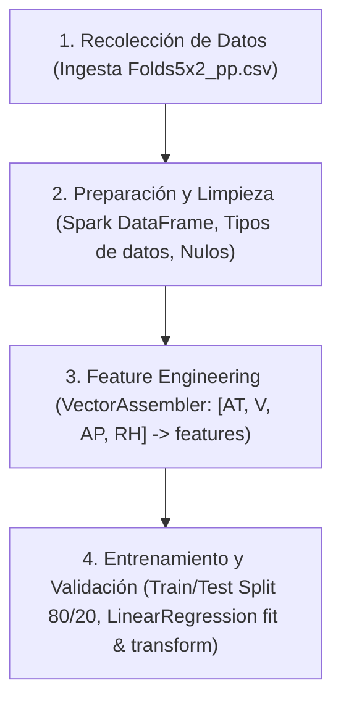

# Guía Teórica y Explicativa para Defensa Académica: Regresión Lineal con Dataset CCPP

**Estudiante:** Ronald Joel Saavedra Vargas  
**Universidad:** Universidad del Valle  
**Asignatura:** LI21 - Exposición con demostración de un caso ejemplo con regresión lineal  
**Dataset Seleccionado:** Combined Cycle Power Plant (CCPP) (`Folds5x2_pp.csv`)  

---

## 1. Mensaje Template para Reservar el Dataset en el Grupo de WhatsApp (Punto 4)

> **[RESERVA OFICIAL DE DATASET - LI21]**
> 
> Estimado docente y compañeros:
> 
> Por medio del presente mensaje, reservo de manera oficial el dataset **Combined Cycle Power Plant (CCPP)** para mi exposición y demostración práctica de Regresión Lineal.
> 
> * **Estudiante:** Ronald Joel Saavedra Vargas
> * **Nombre del Dataset:** Combined Cycle Power Plant Data Set (Folds5x2_pp.csv)
> * **Fuente Oficial (UCI Machine Learning Repository):** [UCI CCPP Dataset Link](https://archive.ics.uci.edu/dataset/294/combined+cycle+power+plant)
> * **Descripción Breve:** El conjunto de datos contiene 9,568 registros recopilados de una planta de energía de ciclo combinado operando a plena carga. Consta de 4 variables predictoras ambientales (Temperatura ambiente, Vacuometría, Presión atmosférica y Humedad relativa) y 1 variable objetivo continua: la producción de energía eléctrica neta por hora (PE en MW). Es ideal para modelar relaciones termodinámicas complejas mediante regresión lineal múltiple.

---

## 2. Punto 6.a: ¿Qué es una Regresión Lineal (LR)?

### Explicación Intuitiva (Para todo público)
Imagina que quieres adivinar cuánto costará alquilar una casa basándote únicamente en su tamaño en metros cuadrados. Intuitivamente, sabes que a mayor tamaño, mayor precio. Si dibujas puntos en un papel (metros cuadrados vs. precio) y trazas una línea recta que pase lo más cerca posible de todos esos puntos, habrás creado un modelo de **Regresión Lineal**. 

La línea recta te permite responder preguntas como: *"Si una casa tiene 120 metros cuadrados, ¿cuánto debería costar aproximadamente?"*, simplemente siguiendo la línea. En términos sencillos, la regresión lineal es una técnica matemática que busca la "mejor" línea recta (o plano multidimensional) para conectar una o varias variables independientes (causas o predictoras) con una variable dependiente (el resultado que queremos predecir).

### Explicación Matemática Rigurosa
Matemáticamente, el modelo de Regresión Lineal Múltiple se expresa como una combinación lineal de las características más un término de error aleatorio:

$$y = \beta_0 + \beta_1 x_1 + \beta_2 x_2 + \dots + \beta_n x_n + \varepsilon$$

Escrita en forma vectorial y matricial:

$$y = \mathbf{x}^T \boldsymbol{\beta} + \varepsilon$$

Donde:
* \( y \in \mathbb{R} \): Es la **variable dependiente** o respuesta (objetivo a predecir).
* \( \mathbf{x} = [1, x_1, x_2, \dots, x_n]^T \): Es el **vector de características** (features), donde el primer elemento es 1 para acomodar el intercepto.
* \( \boldsymbol{\beta} = [\beta_0, \beta_1, \beta_2, \dots, \beta_n]^T \): Es el **vector de pesos** o coeficientes de regresión.
* \( \beta_0 \): Es el **intercepto** (el valor esperado de \(y\) cuando todas las variables predictoras \(x_i = 0\)).
* \( \beta_i \): Es el coeficiente que mide el cambio marginal en \(y\) por cada unidad de cambio en \(x_i\), manteniendo las demás variables constantes (ceteris paribus).
* \( \varepsilon \): Es el **término de error** o perturbación estocástica, que captura la variabilidad no explicada por el modelo, asumiendo una media poblacional de cero (\(E[\varepsilon] = 0\)).

### Función de Pérdida / Coste (RSS, MSE)
Para encontrar la "mejor" línea, necesitamos medir qué tan equivocadas son nuestras predicciones frente a la realidad. 
* **RSS (Residual Sum of Squares / Suma de Residuales al Cuadrado):** Mide la suma total de las desviaciones al cuadrado entre los valores reales (\(y_i\)) y los valores predichos por el modelo (\(\hat{y}_i\)):
  $$\text{RSS} = \sum_{i=1}^{n} (y_i - \hat{y}_i)^2 = \sum_{i=1}^{n} (y_i - (\beta_0 + \sum_{j} \beta_j x_{ij}))^2$$
* **MSE (Mean Squared Error / Error Cuadrático Medio):** Es el promedio del RSS, penalizando de manera cuadrática los errores grandes:
  $$\text{MSE} = \frac{1}{n} \sum_{i=1}^{n} (y_i - \hat{y}_i)^2$$

### Mínimos Cuadrados Ordinarios (OLS) vs. Descenso de Gradiente
* **Mínimos Cuadrados Ordinarios (OLS - Ordinary Least Squares):** Es un método **analítico exacto** que resuelve el problema de optimización igualando la derivada del RSS respecto a \(\boldsymbol{\beta}\) a cero. Su solución cerrada es:
  $$\hat{\boldsymbol{\beta}} = (\mathbf{X}^T \mathbf{X})^{-1} \mathbf{X}^T \mathbf{y}$$
  * *Ventaja:* Da la solución óptima exacta en un solo paso matemático.
  * *Desventaja:* Si la matriz \(\mathbf{X}^T \mathbf{X}\) es muy grande o no invertible (colinealidad extrema), falla o requiere mucha memoria (\(O(n^3)\)).
* **Descenso de Gradiente (Gradient Descent):** Es un método **iterativo numérico** que comienza con pesos aleatorios y va actualizándolos en dirección contraria al gradiente de la función de coste hasta converger al mínimo.
  $$\boldsymbol{\beta}^{(t+1)} = \boldsymbol{\beta}^{(t)} - \alpha \nabla J(\boldsymbol{\beta})$$
  * *Ventaja:* Excelente para datasets masivos (Big Data / PySpark / MLlib) donde calcular la inversa de la matriz es computacionalmente prohibitivo.
  * *Desventaja:* Requiere calibrar la tasa de aprendizaje (\(\alpha\)) y el número de iteraciones.

### Supuestos Clave de Gauss-Markov
Para que los estimadores OLS sean MELI (Mejor Estimador Lineal Insesgado / BLUE en inglés), deben cumplirse los siguientes supuestos:
1. **Linealidad en los parámetros:** La relación entre \(y\) y las \(x\) debe ser lineal.
2. **Homocedasticidad:** La varianza del término de error (\(\sigma^2\)) es constante para todas las observaciones (no hay patrones de dispersión creciente en los residuos).
3. **Independencia (No autocorrelación):** Los errores de las observaciones no están correlacionados entre sí (\(\text{Cov}(\varepsilon_i, \varepsilon_j) = 0\) para \(i \neq j\)).
4. **Normalidad de los residuos:** Los errores siguen una distribución normal con media cero (\(\varepsilon \sim \mathcal{N}(0, \sigma^2)\)), necesario para pruebas de hipótesis e intervalos de confianza.
5. **No multicolinealidad perfecta:** Las variables predictoras no deben estar linealmente correlacionadas de forma exacta entre sí.

---

## 3. Punto 6.b: Escenarios donde se aplica LR

### Casos Reales en la Industria
* **Energía:** Predicción de la demanda eléctrica horaria o rendimiento de turbinas (como nuestro caso CCPP).
* **Finanzas:** Estimación de precios de activos financieros, valoración de carteras hipotecarias y análisis de riesgo crediticio (Credit Scoring).
* **Medicina / Farmacología:** Relación entre la dosis de un medicamento y la reducción de la presión arterial o tiempo de recuperación.
* **Retail y Ventas:** Pronóstico de ventas futuras en función del presupuesto de marketing, estacionalidad y ubicación geográfica.
* **Meteorología y Clima:** Estimación de temperaturas máximas o niveles de radiación solar en función de la humedad y presión barométrica.

### Criterios para Elegir LR
* **Cuándo SÍ usar LR:**
  * Cuando existe una relación aproximadamente lineal entre las variables explicativas y el objetivo continuo.
  * Cuando se requiere **alta interpretabilidad** (explicar exactamente cuánto aporta cada variable al negocio o ciencia).
  * Como modelo base (*baseline*) rápido, eficiente y de bajo costo computacional antes de probar arquitecturas complejas de Deep Learning.
* **Cuándo NO usar LR:**
  * Cuando la relación subyacente es altamente no lineal y compleja (ej. reconocimiento de imágenes, procesamiento de lenguaje natural profundo).
  * Cuando la variable objetivo es categórica o binaria (para eso se usa Regresión Logística o clasificación).
  * Cuando existen interacciones ocultas masivas y no lineales que degradan severamente el rendimiento predictivo del modelo lineal.

---

## 4. Punto 6.c: Descripción del DATASET Seleccionado (CCPP)

### ¿Qué es una Planta Eléctrica de Ciclo Combinado?
Una **Planta de Ciclo Combinado** es una central de generación de energía térmica altamente eficiente que combina dos ciclos termodinámicos en uno solo:
1. **Turbina de Gas (Brayton):** Quema gas natural para mover una turbina y generar electricidad. Los gases de escape salen a temperaturas extremadamente altas (\(>500^\circ\text{C}\)).
2. **Turbina de Vapor (Rankine):** En lugar de desperdiciar ese calor, los gases de escape pasan por un generador de vapor por recuperación de calor (HRSG) para producir vapor a alta presión, el cual impulsa una segunda turbina conectada a otro generador eléctrico.

### Descripción Física de las Variables del Dataset (`Folds5x2_pp.csv`)
El dataset contiene 9,568 registros tomados de una planta que operó durante 6 años (2006-2011) en condiciones ambientales variadas:

| Variable | Nombre Completo | Unidad | Rango Típico | Impacto Termodinámico |
| :--- | :--- | :--- | :--- | :--- |
| **AT** | Ambient Temperature | °C | 1.81°–37.11° | **Principal factor negativo.** A mayor temperatura ambiente, menor es la densidad del aire de admisión en la turbina de gas y peor es la eficiencia del condensador en la turbina de vapor, reduciendo la potencia neta. |
| **V** | Exhaust Vacuum | cm Hg | 25.36–81.56 | **Factor de vacío.** Mide el vacío en el condensador de la turbina de vapor. Un mayor vacío (menor presión absoluta) facilita la expansión del vapor y aumenta la eficiencia y potencia. |
| **AP** | Ambient Pressure | mbar | 992.89–1033.30 | **Presión barométrica.** Una mayor presión atmosférica aumenta la densidad del aire en la admisión del compresor, incrementando ligeramente el flujo másico y la potencia generada. |
| **RH** | Relative Humidity | % | 25.56–100.0% | **Humedad relativa.** Su impacto es el más complejo y sutil; afecta la capacidad calorífica del aire y la evaporación en sistemas auxiliares, teniendo usualmente una correlación positiva débil pero significativa. |
| **PE** | Net Energy Output (Target) | MW | 420.26–495.76 | **Variable Objetivo.** Producción eléctrica neta por hora de la planta completa. |

---

## 5. Punto 6.d: Pasos del Ciclo de ML y su Relación Directa con el Código

El flujo de trabajo profesional en Machine Learning y Big Data (ejecutado en entornos distribuidos como PySpark) sigue estrictamente el siguiente ciclo de 4 fases:

### Relación Directa con el Código (PySpark / Python)
1. **Recolección de Datos:** Carga del archivo CSV mediante SparkSession o Pandas en el clúster.
2. **Preparación y Limpieza:** Conversión de tipos flotantes y verificación de integridad estructural.
3. **Feature Engineering:** Agrupación de las variables independientes en un único vector de características mediante `VectorAssembler`.
4. **Entrenamiento y Validación:** División del dataset en entrenamiento y prueba, ajuste del modelo (`fit`) y predicción (`transform`).

---

## 6. Punto 6.f: Explicación de los Resultados Obtenidos

Supongamos que al entrenar nuestro modelo de regresión lineal múltiple en PySpark obtenemos los siguientes coeficientes estimados:

$$\widehat{PE} = 454.26 - 1.97 \cdot AT - 0.23 \cdot V + 0.06 \cdot AP + 0.12 \cdot RH$$

### Interpretación Física de cada Coeficiente (\(\beta_i\))
* **Intercepto (\(\beta_0 = 454.26\)):** Representa la potencia eléctrica base estimada (en MW) cuando la temperatura ambiente es 0 °C, el vacío es 0 cm Hg, la presión es 0 mbar y la humedad es 0%. *(Nota: Es un valor de referencia matemático, ya que algunas variables nunca toman valor cero en la realidad física).*
* **Coeficiente de AT (\(\beta_1 = -1.97\)):** Por cada grado Celsius (\(1^\circ\text{C}\)) que **aumenta** la temperatura ambiente, la producción eléctrica neta **disminuye en promedio 1.97 MW**, manteniendo constantes el resto de las variables (ceteris paribus). Esto refleja la pérdida termodinámica de eficiencia en las turbinas de gas.
* **Coeficiente de V (\(\beta_2 = -0.23\)):** Por cada centímetro de mercurio que **aumenta** el vacío de escape, la potencia **disminuye en 0.23 MW**.
* **Coeficiente de AP (\(\beta_3 = +0.06\)):** Por cada milibar que **aumenta** la presión atmosférica, la potencia **aumenta en 0.06 MW** debido a la mayor densidad del aire de admisión.
* **Coeficiente de RH (\(\beta_4 = +0.12\)):** Por cada punto porcentual que **aumenta** la humedad relativa, la potencia **aumenta marginalmente en 0.12 MW**.

---

## 7. Punto 6.g: Métricas de Error y Guía de Decisión

### Definición Matemática e Intuitiva de las Métricas

| Métrica | Expresión Matemática | Interpretación Intuitiva |
| :--- | :--- | :--- |
| **R² (Coeficiente de Determinación)** | \(R^2 = 1 - \frac{\sum (y_i - \hat{y}_i)^2}{\sum (y_i - \bar{y})^2}\) | Mide el **porcentaje de la variabilidad total** de la potencia (PE) que es explicado por las variables ambientales en el modelo. Varía de 0 a 1 (o 0% a 100%). |
| **MSE (Error Cuadrático Medio)** | $\text{MSE} = \frac{1}{n}\sum_{i=1}^{n}(y_i - \hat{y}_i)^2$ | Promedio de los errores al cuadrado. Al elevar al cuadrado, **penaliza desproporcionadamente los errores grandes**. Sus unidades están al cuadrado (MW²). |
| **RMSE (Raíz del Error Cuadrático Medio)** | $\text{RMSE} = \sqrt{\text{MSE}}$ | Es la raíz cuadrada del MSE. Vuelve a llevar las unidades a la escala original (MW). Permite interpretar directamente cuánto se desvía en promedio la predicción de la potencia real. |
| **MAE (Error Absoluto Medio)** | $\text{MAE} = \frac{1}{n}\sum_{i=1}^{n}\|y_i - \hat{y}_i\|$ | Promedio de las diferencias absolutas entre real y predicho. **Trata todos los errores de forma lineal**, siendo mucho más robusto ante valores atípicos (outliers). |
| **MAPE (Error Porcentual Absoluto Medio)** | $\text{MAPE} = \frac{100\%}{n}\sum_{i=1}^{n}\left\|\frac{y_i - \hat{y}_i}{y_i}\right\|$ | Expresa el error promedio como un **porcentaje** respecto al valor real, facilitando la comunicación ejecutiva con no técnicos. |

### ¿A qué elementos toma más en cuenta cada una?
* **RMSE:** Sensible a **outliers o errores grandes** (por elevar al cuadrado). Ideal si un error grande en la predicción de energía eléctrica representa un costo operativo crítico.
* **MAE:** Trata **todos los errores por igual** (de forma lineal). Es ideal si el dataset contiene ruido o mediciones anómalas ocasionales que no queremos que distorsionen la evaluación global.
* **R²:** Mide la **bondad de ajuste global** en términos de varianza explicada, independientemente de la escala de la variable.

### Guía de Decisión: ¿Cuándo Elegir Cuál?
1. **Para reportar el ajuste general del modelo en la defensa:** Usa **R²** (ej: *"Nuestro modelo explica el 92.8% de la variabilidad en la generación de energía"*).
2. **Para auditoría técnica de precisión y control de errores grandes:** Usa **RMSE** (ej: *"El error típico de predicción es de \(\pm 4.5\text{ MW}\)"*).
3. **Para reportar métricas intuitivas al negocio o stakeholders no técnicos:** Usa **MAE** o **MAPE** (ej: *"El error porcentual promedio de nuestra predicción es inferior al 1%"*).
